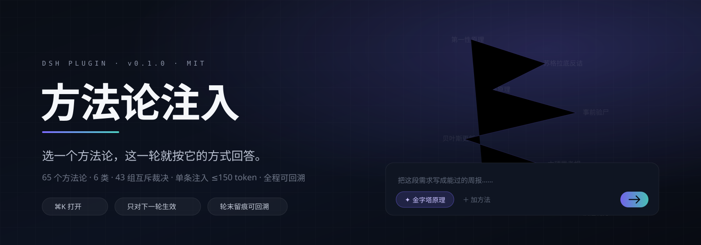
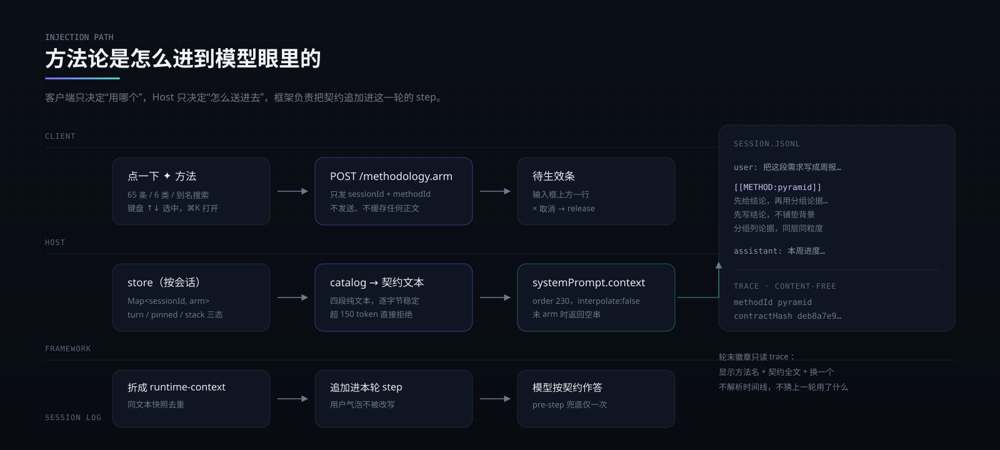

<div align="center">



**选一个方法论，这一轮就按它的方式回答。**

[](https://github.com/suzike/dsh-methodology-injection/releases)
[](LICENSE)
[](https://github.com/deepseek-ai)
[](catalog/methods.json)
[](tests/)

</div>

---

模型不缺知识，缺的是**这一轮该用哪种方式思考**。

我们每天在输入框里写下需求，然后得到一个恰好擅长「列清单」的回答——不是因为它判断错了，而是因为没人在那一轮告诉它：这里要的是先给结论、还是先拆到不可再分、还是先反诘掉自己的假设。

这个插件把那句话变成一个动作：**点一下 ✦，选一个方法论，这一轮的契约就随你的输入一起进到模型眼里。**

- **65 个方法论**，分 6 类：表达组织 / 理解拆解 / 推理求解 / 决策判断 / 创新设计 / 交互引导
- **只对下一轮生效**，默认不粘住；想粘可以锁定，也可以叠一个辅助
- **单轮注入 ≤150 token**，不放论文，只放「怎么想」的四段
- **全程可回溯**：轮末徽章告诉你这一轮用了什么，以及当初注入的契约原文

---

## 目录

- [它长什么样](#它长什么样)
- [一分钟上手](#一分钟上手)
- [契约是怎么进到模型眼里的](#契约是怎么进到模型眼里的)
- [方法论目录](#方法论目录)
- [三种生效方式](#三种生效方式)
- [互斥：同轮只走一条主线](#互斥同轮只走一条主线)
- [留痕与回溯](#留痕与回溯)
- [HTTP 接口](#http-接口)
- [隐私边界](#隐私边界)
- [加一个自己的方法论](#加一个自己的方法论)
- [开发](#开发)
- [已知边界](#已知边界)

---

## 它长什么样

<!-- SHOTS:GALLERY -->

界面上只有三处新增，都不占地方：

| 位置 | 元素 | 作用 |
| --- | --- | --- |
| 输入框左侧 | `✦ 方法` | 点开方法论面板；已选时显示 `✦ 金字塔原理 · 本轮` |
| 输入框上方 | 待生效条 | 发送前告诉你「本条将带上：金字塔原理」，可一键取消 |
| 答完之后 | 轮末徽章 `◆ 金字塔原理` | 点开看这一轮注入的契约原文，可复用、可换一个 |

面板是本地过滤，不调用任何模型：一个键开、一个键走、选中即生效。

---

## 一分钟上手

插件走 DSH 正式插件通道（`~/.dsh/plugins` + profile bundle），重启后长期存在。

```bash
# 1. 放到 DSH 的插件目录（或 symlink 过去）
git clone https://github.com/suzike/dsh-methodology-injection.git \
  ~/.dsh/plugins/dsh-methodology-injection
cd ~/.dsh/plugins/dsh-methodology-injection

# 2. 构建（产物在 lib/，catalog 会一并拷贝）
npm install && npm run build
```

```jsonc
// 3. 登记到 web profile：~/.dsh/profiles/web/package.json
{
  "dependencies": {
    "dsh-methodology-injection": "link:../../plugins/dsh-methodology-injection"
  },
  "dsh": {
    "profile": {
      "bundles": [
        // … 其它 bundle
        "dsh-methodology-injection"
      ]
    }
  }
}
```

```bash
# 4. 让 node_modules 看得见它（Windows 用 mklink /J，类 Unix 用 ln -s）
#    ~/.dsh/profiles/web/node_modules/dsh-methodology-injection
#      -> ~/.dsh/plugins/dsh-methodology-injection
```

5. **重启 DSH**，然后刷新页面。

> 客户端 bundle 不热替换：改了 `src/client/` 里的东西，需要重新 `npm run build` 再刷新页面。

**快速使用**：`⌘K`（或 chip）打开面板 → 输入 `/` 或直接打字搜索 → `↑↓` 选、`Enter` 生效 → 正常写需求、回车发出。

---

## 契约是怎么进到模型眼里的



四段纯文本，逐字节稳定（同一方法论每次生成的注入文本完全一致，便于做前缀缓存）：

```
【方法论】金字塔原理
先给结论，再用分组论据自上而下支撑。
1. 先写结论，不铺垫任何背景
2. 分组列论据，同层同粒度
3. 按一种顺序排列同层并注明
4. 不引入未归组的新观点
结构：结论 ├论据1→依据 ├论据2→依据 └论据3→依据
篇幅：每点一行，不写开场与复述。
```

技术上有四个刻意的决定：

| 决定 | 为什么 |
| --- | --- |
| 走 `systemPrompt.context`（`order: 230`、`interpolate: false`） | 不进用户气泡、不改写你的原话；空串即等于没选，天然零成本 |
| `agent/pre-step` 最多兜底补一次 | 契约被折成 runtime-context 后可能被去重吃掉，兜底保证「选了就一定到」；只补一次，不叠加 |
| 只对会话根 agent 注入 | 子 agent 是执行单元，不该被方法论二次塑形 |
| 超过预算直接拒绝 arm | 150 token 是硬上限，宁可提示你换一个，也不悄悄截断 |

`GET /api/methodology.diagnostics` 会给出最近一次注入的真实落点（`channel`、`landed`、`stage`、`tokenEstimate`、`contractHash`），所以「静默没生效」是可查的，不是玄学。

---

## 方法论目录

65 条，6 类。每条含**注入侧**（positioning / constraints / skeleton / lengthDiscipline）与**阅读侧**（what / whenToUse / misuse / source）两组字段——前者给模型，后者给你自己判断该不该用。

| 类别 | 条数 | 意图 | 举例 |
| --- | --- | --- | --- |
| 表达组织 | 8 | 把已经有答案的东西讲清楚：先说什么、怎么分组、多长说完 | 金字塔原理、SCQA、电梯测试 |
| 理解拆解 | 15 | 把说不清的东西拆开：找边界、找根因、找真正的约束 | 第一性原理、五个为什么、约束扫描 |
| 推理求解 | 10 | 在证据不足时仍给出可检验的下一步 | 贝叶斯更新、反事实推演、钢人化 |
| 决策判断 | 13 | 在多个都说得通的选项里逼出一个能承担的 | 事前验尸、可逆性判断、机会成本 |
| 创新设计 | 10 | 从既有答案里跳出模板 | 逆向工程、嫁接迁移、极端假设 |
| 交互引导 | 9 | 用提问把对方脑子里的东西挖出来 | 苏格拉底提问、苏格拉底反诘、费曼自述 |

264 个别名一并参与搜索：搜「结论先行」能找到金字塔原理，搜「芒格」能找到多元思维模型。

---

## 三种生效方式

| 模式 | 生命周期 | 适合 |
| --- | --- | --- |
| **本轮**（默认） | 用完即焚，只影响下一条消息 | 一次性需求，写完就过去了 |
| **锁定**（pinned） | 一直生效，直到你手动取消 | 连续几轮都在同一个语境里干活 |
| **辅助**（stack） | 主方法之外再叠一条，直到取消 | 想「用金字塔原理组织，同时用费曼自述检查讲不清的地方」 |

默认是本轮，是因为**方法论一旦粘住，就会污染所有无关对话**——写代码和写周报不该用同一套约束。锁定必须是你主动的动作。

---

## 互斥：同轮只走一条主线

有些方法论放在一起会互相拆台：一边要求你先下结论，一边要求你先悬置判断。

所以目录里带了 **43 组两两裁决**，遇到冲突不是报错禁止，而是**明确告诉你该优先用哪个、以及为什么**：

> 问「为什么必须这样、成本底线在哪」用第一性原理；问「这成品怎么实现的」用逆向工程。
> 同轮都需要时：先逆向拆出结构，再用第一性原理校验其中一条关键假设，**不要两头同时展开**。

被明确判为互斥的组合（如苏格拉底提问与金字塔原理），面板会直接拦下并给出中文理由，而不是让你发出一个自相矛盾的请求。

---

## 留痕与回溯

已经发出的对话，靠什么知道上次用了什么？**不靠时间线去猜，靠 trace。**

- 每次真正注入时写一条 trace：`methodId`、契约文本的 `sha256`、turn、时间、token 估算
- 轮末徽章读 trace 渲染，点开显示**当初注入的契约全文**（不是重新生成的近似文本）
- 想再来一次：徽章里点「复用」，组合（主 + 辅助 + 模式）原样恢复
- 换会话、刷新页面、重启 DSH 之后依然可查

trace 是**内容无关**的：只有方法 id、hash 和时间戳，没有你的任何一句话。

---

## HTTP 接口

本机回环，前端与 Host 同一进程域内通信：

| 方法 | 路径 | 说明 |
| --- | --- | --- |
| `GET` | `/api/methodology.state?sessionId=` | 当前会话的 arm 状态（主 / 辅助 / 模式 / turn） |
| `POST` | `/api/methodology.arm` | `{ sessionId, methodId, assists?, mode? }` 选中并生效 |
| `POST` | `/api/methodology.release` | `{ sessionId, methodId? }` 取消，省略则清空该会话 |
| `GET` | `/api/methodology.trace?sessionId=&turn=` | 某轮的真实注入记录（含契约 hash） |
| `GET` | `/api/methodology.diagnostics` | 最近一次注入的落点与降级原因 |

所有写接口只接受本机会话 id，不接受路径、不接受任意 URL；不提供删除历史能力（trace 只增）。

---

## 隐私边界

这个插件在「记录你怎么想」的边缘上，所以约束写死在这里：

- ❌ 不保存你的 prompt，不保存模型的回答，不保存文件路径
- ❌ 不发任何请求到本机之外
- ✅ 只存：方法 id、契约文本 hash、turn 编号、时间戳、token 估算
- ✅ 存储位置：`$DSH_HOME/dsh-methodology-injection.json`（原子写，临时文件 + rename）

你可以随时打开那个 JSON 自己核对——里面找不到任何一句你打过的话。

---

## 加一个自己的方法论

编辑 `catalog/methods.json`，然后 `npm run build` + 刷新：

```jsonc
{
  "id": "your-method",
  "zh": "你的方法论",
  "en": "Your Method",
  "category": "reasoning",
  "aliases": ["别名一", "alias-two"],
  "oneliner": "一句话说清它逼你做什么",
  "inject": {
    "positioning": "它在回答里坐在哪个位置。",
    "constraints": ["动词开头的硬约束", "最多四条"],
    "skeleton": "用 ASCII 画一个结构骨架",
    "lengthDiscipline": "篇幅纪律：不许因为结构而变长。"
  },
  "display": {
    "what": "它是什么、谁提出的。",
    "whenToUse": "什么时候该用它。",
    "misuse": "最常见的误用是什么。",
    "source": "可核对的出处。"
  },
  "conflicts": ["与它互斥的 id"]
}
```

改完跑 `node scripts/validate-catalog.mjs`：会逐条检查字段完整、注入预算、别名唯一、互斥对称。**没有通过校验的目录不会被打包。**

---

## 开发

| 命令 | 作用 |
| --- | --- |
| `npm run typecheck` | Host 与 Client 两套 tsconfig 全量类型检查 |
| `npm run build` | 清空 `lib/` → tsc(Host) → tsdown(Client) → 拷贝 catalog |
| `npm test` | `node --test tests/*.test.mjs`，25 条（Host 契约 + 客户端接线） |
| `npm run verify` | 上面三者串联，提交前跑这个 |
| `node scripts/validate-catalog.mjs` | 目录校验 + 预算报告 |
| `node scripts/simulate-turn.mjs` | 不连 DSH，模拟一轮注入，打印最终进模型的文本 |

结构：

```
src/lib/      Host：catalog 装配、契约拼装、预算估算、store、注入管线、HTTP 路由
src/client/   前端：chip / 面板 / 待生效条 / 轮末徽章 / store / 搜索 / 快捷键
catalog/      65 条方法论 + 43 组互斥裁决
tests/        Host 契约测试与客户端接线测试
docs/assets/  README 用图
PROBE.md      真实的扩展点契约勘察报告（为什么这么接，全在这里）
```

---

## 已知边界

- 只对**会话根 agent**生效，子 agent 不继承——这是设计，不是缺陷
- `⌘K` 被别的插件占用时会自动让位（检测 `defaultPrevented`），退到 `⌘⇧M`
- 面板零模型调用；任何「AI 推荐/润色」都需要你显式点按钮，超时 8 秒即放弃
- 契约不保证模型一定遵守——它把「该用哪种方式」说清楚，但模型仍可能跑偏；徽章能让你回看当初到底注入了什么

---

<div align="center">

MIT © [suzike](https://github.com/suzike)

<sub>方法论是给人用的，不是给模型背的。这个插件只做一件事：让那一轮知道该用哪一种。</sub>

</div>
